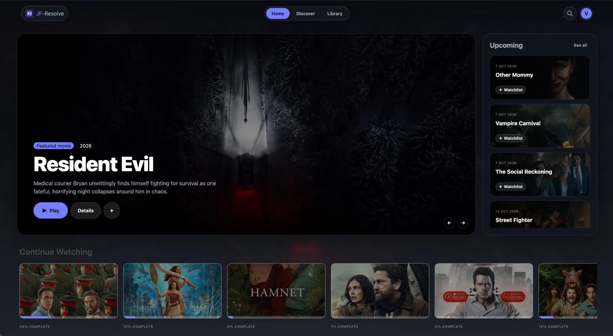
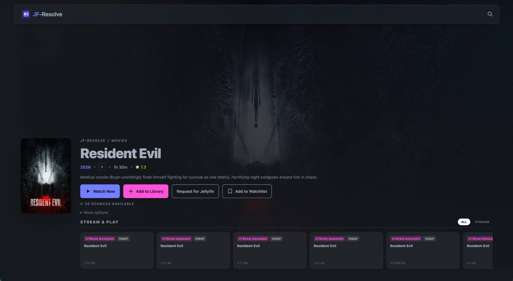
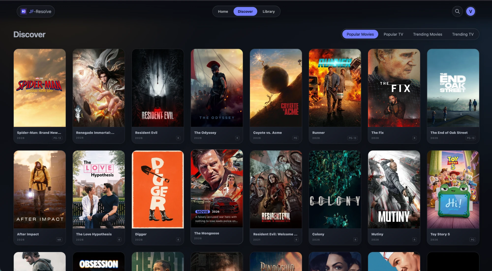

<p align="center">
  
</p>

# JF-Resolve

Browse movies and TV from TMDB and play them from Stremio addons, in the browser or through Jellyfin.

<p align="center">
  <a href="https://discord.gg/hPz3qn72Ue" target="_blank">
    
  </a>
</p>

Prefer something that lives inside Jellyfin? Use the plugin instead: [jfresolve](https://github.com/vicking20/jfresolve).






## Features

- **Discover and search** movies and shows from TMDB.
- **Web player** with a source picker, audio track and subtitle selection, and on-the-fly transcoding with FFmpeg when the browser can't play a file.
- **Addon streams** from any Stremio addon manifest (Torrentio, AIOStreams, Comet, …). Results keep the addon's own ranking. Debrid services are configured in the addon, not here.
- **Torrent playback** through a bundled TorrServer, with a P2P fallback for Torrentio. Seeding is off unless you turn it on in Settings.
- **Local library**: scan your own folders and play those files alongside addon streams.
- **Jellyfin output**: writes `.strm` files for movies and every episode, and triggers a Jellyfin library scan.
- **Requests**: in Jellyfin mode, users request titles and an admin approves them.
- **Users and parental controls**: per-user content rating limits apply to browsing and playback.
- **Watchlist, progress and continue watching.**
- **Subtitles**: embedded tracks, your own SRT/VTT files, and OpenSubtitles through the Stremio Subtitles plugin.
- **Plugins** installable from the built-in marketplace.

### Modes

Pick one during setup; change it later in Settings.

| Mode | Web player | Jellyfin `.strm` output |
|---|---|---|
| Standalone | ✓ | |
| Jellyfin | | ✓ |
| Hybrid | ✓ | ✓ |

## Requirements

- Python 3.12 (newer versions may not have wheels for every dependency)
- FFmpeg on your `PATH` for transcoding and subtitles
- A TMDB API key
- A Stremio addon manifest URL, for example from Torrentio or AIOStreams

## Install

### Docker

The image is built locally; no image is published.

```bash
docker compose up -d --build
```

Or without Compose:

```bash
./docker-run.sh
```

Open `http://<server-ip>:8765`. Data and plugins are kept in `./data`, `./experimental/data` and `./experimental/plugins`.

**For Jellyfin or Hybrid mode**, create a `.env` next to `docker-compose.yml` that points at folders Jellyfin reads:

```bash
JELLYFIN_MOVIES_DIR=/srv/jellyfin/strm/movies
JELLYFIN_TV_DIR=/srv/jellyfin/strm/tv
```

Then in JF-Resolve Settings:

- Movie directory: `/strm/movies`
- Series directory: `/strm/tv`
- JF-Resolve URL for Jellyfin: `http://<server-ip>:8765` (an address Jellyfin can reach, not `127.0.0.1`)

Add the same host folders as libraries in Jellyfin.

### Linux / macOS

```bash
bash setup.sh
source venv/bin/activate
python start.py
```

`setup.sh` also installs TorrServer for torrent playback. If that step fails, run `python scripts/install_torrserver.py` later.

To run it in the background instead: `./run.sh start`, `./run.sh stop`, `./run.sh status`, `./run.sh logs`.

### Windows (PowerShell)

```powershell
py -3.12 -m venv venv
.\venv\Scripts\Activate.ps1
$env:PYTHONUTF8 = "1"
python -m pip install -r requirements.txt
python scripts/install_torrserver.py
python start.py
```

### Upgrading from 1.x

Old STRM files stop working after the upgrade. See [scripts/MIGRATING.md](scripts/MIGRATING.md) for the migration script.

## First run

1. Open `http://127.0.0.1:8765`.
2. Create the admin account and choose a mode.
3. Add your TMDB key.
4. In Settings → Plugins, configure Stream Manager with your addon manifest URL.
5. For Jellyfin or Hybrid, fill in the Jellyfin URL, API key and STRM folders.

## Plugins

Streams, catalogues and subtitles come from plugins. Stream Manager and TMDB Core ship with the app; others install from the marketplace. The official repository is added by default.

| Plugin | What it does |
|---|---|
| Stream Manager | Streams from a Stremio addon manifest URL |
| The Movie Database (Core) | Popular, Trending and Top Rated catalogues |
| Stremio Subtitles | Subtitles from OpenSubtitles or any Stremio subtitle addon. No API key needed. |

To install a plugin, go to **Settings → Plugins → Plugin Marketplace** and click **Install**. Then click **Configure** on the plugin in Settings → Plugins to set it up, for example to paste your addon URL into Stream Manager.

To add another repository, use **Add Plugin Repository** in the marketplace and paste the URL of its `master.json`.

### Writing a plugin

A plugin is a folder with:

- `manifest.json`: `id`, `name`, `version`, `description`, `author`, `capabilities`
- `plugin.py`: a `Plugin` class extending `BasePlugin` plus one or more of `SourceProvider`, `CatalogueProvider` or `SubtitleProvider` from `backend.addons.interfaces`
- `config.html` (optional): form fields for its settings, saved to the plugin's `default_config` keys

A repository is a `master.json` listing each plugin and the raw URLs of its files. See [jf-resolve-plugin-repo](https://github.com/vicking20/jf-resolve-plugin-repo) for working examples.

## Jellyfin output

Adding a title to the library (as admin) or approving a request writes:

```
movies/
  Movie Title (2024)/
    Movie Title (2024).strm
tv/
  Show Title (2024)/
    Season 01/
      Show Title (2024) - S01E01 - Episode Name.strm
```

Each file holds a link back to JF-Resolve. When Jellyfin plays it, JF-Resolve asks your addons for streams and redirects to the first playable one, in the addon's order. To control which release plays, set up sorting and filters in the addon (AIOStreams is good at this). Magnet links and streams that need custom headers are skipped, since Jellyfin can't follow them.

Removing a title deletes only folders JF-Resolve created (they contain a `.jfresolve` marker).

## Troubleshooting

- **Nothing shows up in Jellyfin:** check the STRM folders are mounted and added as Jellyfin libraries, then run a library scan.
- **Jellyfin can't play a title:** make sure the JF-Resolve URL in Settings is reachable from the Jellyfin server, and check the logs page.
- **No streams:** check the addon URL and that your debrid account is active.
- **Browser can't play a stream:** pick another source from the player's source menu, or make sure FFmpeg is installed.

Logs are on the Logs page (admin only) and in `experimental/data/logs/`.

## Disclaimer

For personal and educational use. You are responsible for complying with the terms of TMDB, Jellyfin, Stremio addons and any debrid service you use.
